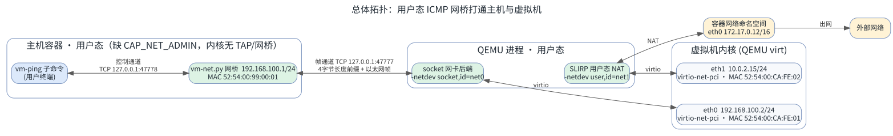
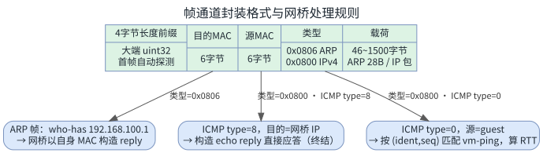
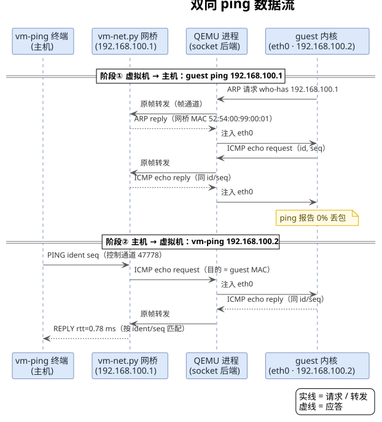

# LV020：主机 ↔ 虚拟机互通原理 —— 用户态 ICMP 网桥

> 容器开发环境里没有 `CAP_NET_ADMIN`，建不了内核 TAP/网桥；而 QEMU 默认的 SLIRP 网络又不支持主机入站 ICMP——于是主机与虚拟板卡之间"ping 不通"。本文记录一个绕开内核权限的方案：用 QEMU 的 `-netdev socket` 网卡后端，把 guest 的以太网帧原样交给一个用户态小程序 `vm-net.py`，在用户态终结 ARP/ICMP，实现主机与 guest 之间**真实的双向 ping**，同时保留 SLIRP 通道供 guest 出网。

## 一、 问题背景：为什么默认网络 ping 不通

### 1. QEMU virt 的默认网络是 SLIRP

`-machine virt` 不写任何网络参数时，QEMU 自动挂一块 `virtio-net-pci` 并接入 **user-mode 网络（SLIRP）**。SLIRP 是 QEMU 进程内的一个**纯用户态 TCP/IP 协议栈**，对 guest 表现为一台 NAT 路由器：guest 处于 `10.0.2.0/24` 网段，网关 `10.0.2.2`。

关键特性：guest 发出的以太网帧**全部终结在 QEMU 进程内**，经 NAT 转换后以宿主进程的系统调用（普通 socket）出去，永远不会以原始以太网帧的形式出现在主机内核的任何接口上。这决定了：

| 方向 | 行为 |
|------|------|
| guest → 外部 | 可以。出站 NAT，guest 配好 IP 即可出网 |
| 主机 → guest | 只剩 `hostfwd` 端口转发（TCP/UDP）；**ICMP 没有入站路径**，ping 永远不通 |

### 2. 常见误区：给 guest 配同网段 IP 就能通吗

不能。假设主机 eth0 是 `172.17.0.12/16`，把 guest 配成 `172.17.0.100`：

- 主机 `ping 172.17.0.100`：内核在 eth0 上发 ARP 查询，L2 网络上没有任何设备应答——guest 根本不在这条链路上，不通；
- 反方向 guest `ping 172.17.0.12`：SLIRP 把它当"外网"流量 NAT 绕出去，不是直连，且主机方向的回程路径依然不存在；
- guest 想真正出现在 172.17.0.0/16 的链路上，唯一途径是网桥/TAP——回到权限问题（下节）。

一句话：**ping 需要的是 L2 互通，SLIRP 只提供 L3 单向 NAT，两者根本不在一个层面。**

### 3. 标准解法 TAP 为什么在本环境不可行

标准做法是内核 TAP 设备：QEMU 打开 `/dev/net/tun`，用 `TUNSETIFF` 关联一个 tap 接口，主机内核与 guest 在 L2 直通，两侧配同网段 IP 即可原生 ping。但每一步都要求特权：

| 需要的操作 | 需要的权限 | 本容器实测结果 |
|------|------|------|
| 创建 tap 设备 / 给接口配 IP | `CAP_NET_ADMIN` | CapEff / CapBnd 均无此能力位 |
| 创建 `/dev/net/tun` 设备节点 | mknod 系统调用可用 | seccomp 拦截，`mknod` 返回 EPERM |
| 借权：privileged 辅助容器进 netns 代建 | 可用且允许特权运行的 dockerd | 实测该 dockerd 起任何容器都失败（mount sysfs EPERM） |

结论：**内核态方案全部出局——那就把二层网桥做在用户态。**

## 二、 方案总体架构

QEMU 提供了一个现成的口子：`-netdev socket` 网卡后端。它把 guest 收发的以太网帧**原样**通过一条 TCP 连接递给外部程序（每帧前加 4 字节长度前缀）。我们在用户态写一个最小的"ARP + ICMP 协议栈"（`vm-net.py`，约 300 行 Python，仅标准库），冒充链路对端：



### 1. 两块网卡的分工

guest 配两块固定 MAC 的 `virtio-net-pci`，各走一条通道：

| 网卡 | MAC（固定） | IP | QEMU 后端 | 用途 |
|------|------|------|------|------|
| eth0 | `52:54:00:CA:FE:01` | 192.168.100.2/24 | `-netdev socket` → vm-net.py | 主机 ↔ guest 互 ping |
| eth1 | `52:54:00:CA:FE:02` | 10.0.2.15/24 | `-netdev user`（SLIRP） | guest 出网（网关 10.0.2.2） |

- 驱动上 `CONFIG_VIRTIO_PCI` + `CONFIG_VIRTIO_NET` 已编入内核（`qemu_defconfig`），无需额外模块；
- `192.168.100.0/24` 是新分配的空闲私网，刻意避开容器真实网段 `172.17.0.0/16`，避免语义混淆；
- guest 侧静态配网写在 rootfs 的 `/etc/rc.sh`（busybox ifconfig/route）。

### 2. 为什么按固定 MAC 配网

`rc.sh` 遍历 `/sys/class/net/eth*`，**按 MAC 匹配**决定配哪个 IP，而不是按 `eth0`/`eth1` 命名。多网卡下接口命名由 PCI 槽位枚举顺序决定——QEMU 里虽是确定的，但按 MAC 配网与命名解耦：将来调整 `-device` 顺序、换网卡后端，配置脚本一行不用改。

## 三、 关键机制

### 1. 帧通道：`-netdev socket` 的封装格式



- QEMU 的 socket 后端在 TCP 流上传以太网帧，每帧前有 **4 字节长度前缀**（uint32），帧体是原始以太网帧（目的 MAC | 源 MAC | 类型 | 载荷）；
- 长度前缀的字节序没有强协议约定（QEMU 实现按本地字节序写入），网桥在**首帧做自动探测**：分别按大端/小端解读，取满足"帧长 ∈ [14, 2048] 且 ethertype ∈ {0x0806, 0x0800, 0x86DD}"的解读，整条连接沿用该结论；
- 帧长上限 2048 是保护：长度前缀解错时不至于把后续字节流误当超长帧死等。

### 2. ARP：让 guest 相信"主机"在链路上

guest 要 ping 192.168.100.1，第一步是广播 ARP。网桥监听帧通道，遇到 "who-has 192.168.100.1" 就以固定 MAC `52:54:00:99:00:01` 回 ARP reply——这是个本地管理地址，任意选定，只要与 `vm-net.py` 里的常量一致即可。此后 guest 的 ARP 缓存建立，双向流量不再需要 ARP。

### 3. ICMP echo 的两个方向

**方向一：guest → 主机（网桥终结）**
echo request 的目的 IP 是网桥自身 192.168.100.1，网桥直接构造 echo reply（type 8→0，重算校验和）注入帧通道。这是真实的 ICMP 往返，guest `ping` 命令的统计（丢包率/RTT）完全真实。

**方向二：主机 → guest（vm-ping 借道控制通道）**
主机内核 ping 不通是预期的——192.168.100.0/24 只存在于两个用户态进程之间，内核没有这个路由。主机侧改用 `python3 vm-net.py ping 192.168.100.2`：

1. vm-ping 经控制通道（TCP 127.0.0.1:47778）下发 `PING ident seq`；
2. 网桥构造 echo request——目的 MAC 直接用约定的 guest MAC，省一次 ARP——注入帧通道，并登记 `(ident, seq)` 到 pending 表；
3. guest 回 echo reply，经 QEMU 原样到达网桥；
4. 网桥按 `(ident, seq)` 匹配 pending 表，计算 RTT，向控制通道回 `REPLY <ms>`（2 秒超时回 `TIMEOUT`）；
5. vm-ping 打印与系统 ping 同风格的统计输出。

### 4. 校验和

IP 头与 ICMP 的校验和都是 16 位反码求和：逐 16 位累加（奇数长度补零），高 16 位折叠进低 16 位，取反码。回 echo reply 时 type 从 8 改 0、重算 ICMP 校验和；源/目的 IP 互换后 IP 头校验和也要重算——漏算任何一个，guest 都会静默丢包。

## 四、 双向数据流



- **阶段①** guest 发起 ping：ARP 一问一答建立缓存，之后 ICMP echo request/response 各走一跳帧通道，guest 侧 `ping` 统计 0% 丢包；
- **阶段②** 主机 vm-ping 发起：控制通道一条命令，帧通道一个来回，RTT 由网桥按收发时间差计算；
- 图中"原帧转发"强调 QEMU 在这条链路上是**透明中继**：它不理解也不修改帧内容，只负责 virtio 队列与 TCP 流之间的搬运——协议逻辑全在两端的 guest 内核与 vm-net.py。

## 五、 方案对比

| 方案 | 互通方向 | ICMP | 需要的权限 | 主机侧工具 | 适用场景 |
|------|------|------|------|------|------|
| SLIRP（默认） | 仅出站 | 入站无路径 | 无 | —— | guest 出网 |
| SLIRP + hostfwd | 双向 | ✗（仅 TCP/UDP） | 无 | telnet / nc | 端口级访问 |
| TAP + 网桥 | 双向 | ✓ 原生 | `CAP_NET_ADMIN` | 系统 ping | 有权限的机器（首选） |
| **vm-net 网桥（本方案）** | 双向 | ✓ | 无 | `python3 vm-net.py ping` | 无特权的容器环境 |

## 六、 局限与扩展方向

- 网桥只终结 ARP/ICMP，TCP/UDP 不转发。若有需求，可扩展用户态 TCP 终结，或干脆叠加 `hostfwd` 做端口映射；
- 守护进程**常驻**：QEMU 退出后等待重连，下次 `./build_qemu.sh -r` 复用；`pkill -f vm-net.py` 可停；
- 网桥绑定 `127.0.0.1`，不接受外部连接，无暴露面；
- 在有 `CAP_NET_ADMIN` 的机器上，建议换回 TAP 直连（原生 ping、性能更好），guest 侧因按 MAC 配网无需改动：

  ```bash
  # 主机侧（替代 vm-net.py 网桥）
  ip tuntap add dev tap0 mode tap
  ip addr add 192.168.100.1/24 dev tap0
  ip link set tap0 up
  # QEMU 侧替换 socket 后端
  -netdev tap,id=net0,ifname=tap0,script=no,downscript=no \
      -device virtio-net-pci,netdev=net0,mac=52:54:00:CA:FE:01
  ```

## 七、 实测记录

主机 → 虚拟机（vm-ping，4/4 收到，RTT 0.70~4.83 ms）：

```text
$ python3 vm-net.py ping 192.168.100.2 -c 4
PING 192.168.100.2 (192.168.100.2) via vm-net bridge, 32 bytes of data
64 bytes from 192.168.100.2: icmp_seq=1 ttl=64 time=4.83 ms
64 bytes from 192.168.100.2: icmp_seq=2 ttl=64 time=1.01 ms
64 bytes from 192.168.100.2: icmp_seq=3 ttl=64 time=0.78 ms
64 bytes from 192.168.100.2: icmp_seq=4 ttl=64 time=0.70 ms
--- 192.168.100.2 ping statistics ---
4 packets transmitted, 4 received, 0% packet loss, rtt min/avg/max = 0.70/1.83/4.83 ms
```

虚拟机 → 主机（guest 内核原生 ping，0% 丢包）与出网：

```text
~ # ping -c 4 192.168.100.1
4 packets transmitted, 4 packets received, 0% packet loss
~ # ping -c 1 10.0.2.2          # SLIRP 网关, 出网方向
1 packets transmitted, 1 packets received, 0% packet loss
```

网桥日志（out/vm-net.log）可见完整的 ARP/ICMP 事件流：

```text
帧通道就绪: 127.0.0.1:47777 (等待 QEMU -netdev socket 接入)
QEMU 已接入
帧长前缀字节序探测结果: !
ARP who-has 192.168.100.1 tell 192.168.100.2 -> reply(525400990001)
ICMP echo reply 192.168.100.2(id=57478 seq=1) -> vm-ping
ICMP echo request 192.168.100.2(id=65 seq=0, 56 bytes) -> reply
```

## 八、 文件与参数速查

| 项 | 值 | 定义位置 |
|------|------|------|
| guest eth0 IP | 192.168.100.2/24 | `build_qemu.sh` 常量 `VM_NET_GUEST_IP` |
| 主机侧网桥 IP | 192.168.100.1/24 | `vm-net.py` `BR_IP` / `build_qemu.sh` `VM_NET_HOST_IP` |
| 网桥侧 MAC | 52:54:00:99:00:01 | `vm-net.py` `BR_MAC` |
| guest 两网卡 MAC | 52:54:00:CA:FE:01 / :FE:02 | `build_qemu.sh` `NET_MAC_BR` / `NET_MAC_USR` |
| 帧通道 | TCP 127.0.0.1:47777 | `VM_NET_QEMU_PORT`（可环境变量覆盖） |
| 控制通道 | TCP 127.0.0.1:47778 | `VM_NET_CTRL_PORT`（可环境变量覆盖） |
| 网桥日志 | `out/vm-net.log` | `build_qemu.sh` `setup_vm_net()` |

相关文件：

- `vm-net.py` —— 网桥守护进程（`daemon` 子命令）+ 主机侧 ping 客户端（`ping` 子命令）+ 在位探测（`probe` 子命令）；
- `build_qemu.sh` —— `setup_vm_net()` 幂等拉起网桥并拼装 QEMU 网络参数（失败自动回退纯 SLIRP）；`gen_init_shell()` 生成的 `/etc/rc.sh` 按 MAC 静态配网并 `ifconfig lo up`；
- `docs/LV020-用户态ICMP网桥互通原理/` —— 本文配图的 dot/puml 源文件与渲染产物（改图先改源再重渲染）。
